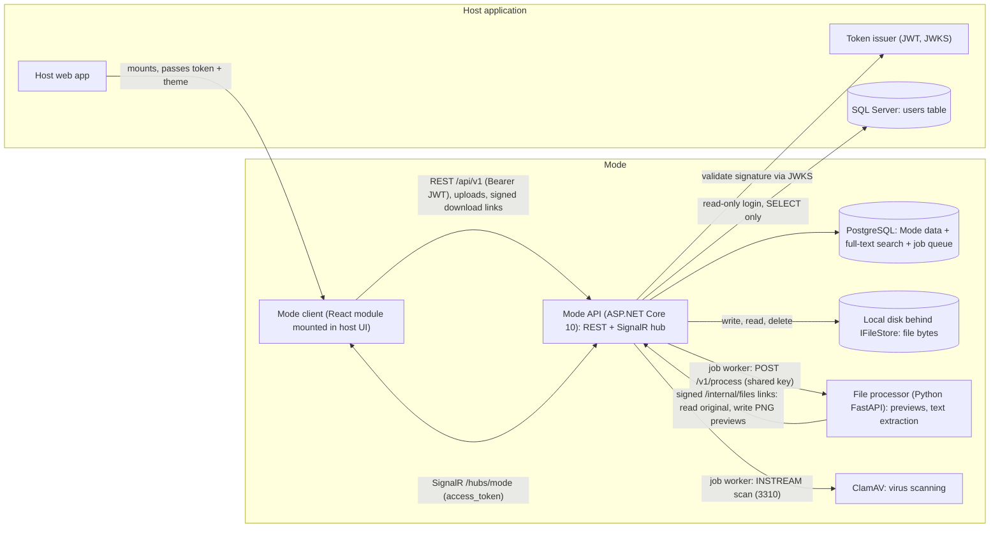
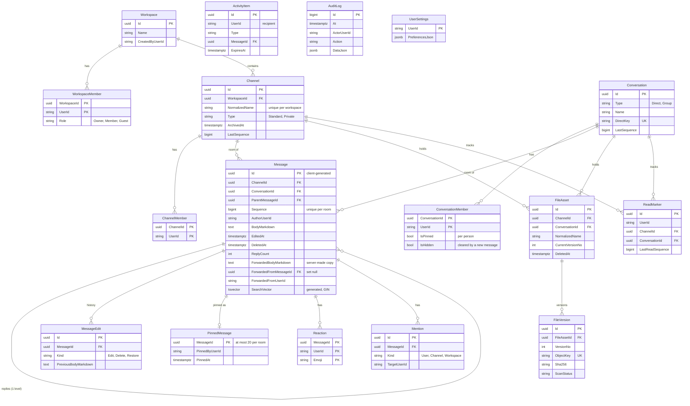

# Mode architecture

Mode is a lightweight collaboration module for UBA (up to 1,000 users). It is merged into a host application that owns user accounts and sign-in. Mode reads users from the host and stores only its own data.

## 1. Components



Local development replaces the host token issuer with `tools/Mode.MockIssuer` and the host users table with the `ModeHostMock` database (`db/host-mock/setup.sql`).

### Service boundaries

| Component | Separate process? | Why |
| --- | --- | --- |
| REST API, SignalR hub, authorization, chat path | No, one .NET process | Keep the chat hot path in a single service; simplest to secure and operate |
| File processor (Python) | Yes | Python libraries for previews and text extraction are clearly better; runs off the hot path through a queue |
| ClamAV | Yes (stock image) | Standard daemon, scanned over TCP |
| PostgreSQL | Yes (stock image) | Data store; also the job queue |
| File storage | No: a folder on the server's disk | Behind `IFileStore`, so an S3-compatible store can replace it later |

## 2. Capacity

- Target: 1,000 users, about 1,000 concurrent SignalR connections on one server. One Kestrel process handles this comfortably.
- The API is stateless apart from in-memory caches (directory lookups, presence). Scaling out later needs a SignalR backplane (Valkey) and a shared presence cache. Nothing else in the design assumes a single node.
- Message ordering uses a per-room counter row (`LastSequence`), so concurrent sends to the same room are serialized by a row lock while sends to different rooms run in parallel.
- Search uses a stored `tsvector` column with a GIN index, so no search cluster is needed.

## 3. Data model

There is no Mode user table. Every `*UserId` column holds the host application's user id as an opaque string of up to 64 characters. The host database is a separate SQL Server, so these columns have no foreign keys. Identity is looked up through `IUserDirectory`.



`ReadMarker` is the last-read part of user settings. It is a separate table so updating it doesn't rewrite the preferences row. `ActivityItem` also has optional foreign keys to `Workspace`, `Channel` and `Conversation`; the diagram omits these edges for readability. `AuditLog` deliberately has no foreign keys so entries outlive what they describe. Database triggers (`audit_logs_no_change`, `audit_logs_no_truncate`) make `AuditLogs` append-only.

Governance tables (D46): `RetentionPolicies` (one per workspace, `KeepDays` or null for forever), `LegalHolds` (on a channel, chat or person; released, never deleted), `Webhooks` (group chat target, SHA-256 of the secret, rotate and revoke times), `DlpSettings` (a single row: blocked file types and message patterns as JSON) and `ComplianceExports` (filters, status, ZIP storage key, manifest hash and signature). `Message.BotName` is set on webhook posts, whose author id is `bot:{webhookId}`.

Entities: [src/Mode.Domain/Entities](../src/Mode.Domain/Entities). Mapping: [src/Mode.Infrastructure/Data/Configurations](../src/Mode.Infrastructure/Data/Configurations).

### Message rules

1. **Exactly one room.** The `CK_Messages_SingleRoom` check constraint requires exactly one of `ChannelId` and `ConversationId`. The same constraint applies to `FileAsset` and `ReadMarker`.
2. **One level of threading.** `ParentMessageId` must point to a top-level message in the same room. The API enforces this. Parents keep `ReplyCount` and `LastReplyAt` up to date.
3. **Ordering.** Each send runs `UPDATE <room> SET "LastSequence" = "LastSequence" + 1 ... RETURNING "LastSequence"` in the same transaction as the insert. Unique indexes on `(ChannelId, Sequence)` and `(ConversationId, Sequence)` back this up. Replies share the room sequence, so a client can detect any gap in what it has received.
4. **Idempotent sends.** `Message.Id` is generated by the client. A retried send with the same id returns the existing message instead of creating a new one.
5. **Soft edit and delete.** An edit copies the old body into `MessageEdit` (Kind=Edit) and sets `EditedAt`. A delete copies the body into `MessageEdit` (Kind=Delete), sets `DeletedAt` and `DeletedByUserId`, and empties `BodyMarkdown`, which also removes the message from search. Regular users see an "Edited" label or a tombstone. Authors can read their own earlier edits (`GET /messages/{id}/history`), but text removed by a delete is never shown to users. Compliance admins can read all of `MessageEdit` until retention removes it.
6. **Direct chats** have `DirectKey` = the two user ids sorted and joined with `|`. A unique index makes them one per pair. `CK_Conversations_DirectKey` ensures only direct chats have a key.

## 4. REST API outline

Base path `/api/v1`. Every request carries `Authorization: Bearer <host JWT>`. Errors use RFC 7807 problem details. Lists use cursor pagination: `?before=<sequence|cursor>&limit=50` (maximum 100), and responses look like `{ items: [...], nextCursor: string|null }`.

| Area | Verb and route | Request | Response |
| --- | --- | --- | --- |
| Me | `GET /me` | | `{ user: UserDto, roles, settings }` |
| Users | `GET /users/search?q=&limit=` | | `UserDto[]` (not available to guests) |
| | `GET /users/{id}` | | `UserDto` |
| Workspaces | `GET /workspaces` | | `WorkspaceDto[]` (mine) |
| | `POST /workspaces` | `{ name, description? }` | `201 WorkspaceDto` |
| | `PATCH /workspaces/{id}` | `{ name?, description? }` | `WorkspaceDto` |
| | `GET /workspaces/{id}/members` | | `MemberDto[]` |
| | `POST /workspaces/{id}/members` | `{ userId, role }` | `201 MemberDto` |
| | `PATCH /workspaces/{id}/members/{userId}` | `{ role }` | `MemberDto` (refuses to demote the last owner) |
| | `DELETE /workspaces/{id}/members/{userId}` | | `204` (refuses to remove the last owner) |
| Channels | `GET /workspaces/{id}/channels` | | `ChannelDto[]` (only channels the caller can read) |
| | `POST /workspaces/{id}/channels` | `{ name, description?, type }` | `201 ChannelDto` |
| | `PATCH /channels/{id}` | `{ name?, description? }` | `ChannelDto` |
| | `POST /channels/{id}/archive` | | `ChannelDto` |
| | `GET / POST / DELETE /channels/{id}/members[/{userId}]` | `{ userId }` | `MemberDto[]` / `201` / `204` |
| Conversations | `GET /conversations` | | `ConversationDto[]` |
| | `POST /conversations` | `{ type: "direct", userId }` or `{ type: "group", userIds, name? }` | `200` (existing direct) or `201 ConversationDto` |
| | `PATCH /conversations/{id}` | `{ name }` (group only) | `ConversationDto` |
| | `POST / DELETE /conversations/{id}/members[/{userId}]` | `{ userId }` | `201` / `204` |
| Messages | `GET /channels/{id}/messages`, `GET /conversations/{id}/messages` | `?before=&limit=` or `?after=&limit=` | page of `MessageDto`: newest first with `nextBefore`; with `after`, oldest first with `nextAfter` (open at the first unread) |
| | `POST /channels/{id}/messages`, `POST /conversations/{id}/messages` | `{ id, bodyMarkdown, parentMessageId?, fileIds? }` | `201 MessageDto` or `200` if the id already exists |
| | `GET /messages/{id}/replies` | `?after=&limit=` | page of `MessageDto` (oldest first) |
| | `PATCH /messages/{id}` | `{ bodyMarkdown }` | `MessageDto` (author only) |
| | `DELETE /messages/{id}` | | `204` (author, or a channel or workspace owner) |
| | `POST /messages/{id}/restore` | | `MessageDto` (author, only for their own delete) |
| | `GET /messages/{id}/history` | | `MessageVersionDto[]`, oldest first (author only) |
| | `PUT / DELETE /messages/{id}/pin` | | `MessageDto` (anyone who can post; top-level only; at most 20 per room) |
| | `GET /conversations/{id}/pins`, `GET /channels/{id}/pins` | | `PinDto[]`, newest pin first |
| | `POST /messages/{id}/forward` | `{ id, to: { type, id }, bodyMarkdown? }` | `201 MessageDto` with `forwarded` (read access to the source, post access to the target) |
| | `PUT /conversations/{id}/settings` | `{ isPinned?, isHidden? }` | `ConversationDto` (your own chat list only) |
| | `PUT / DELETE /messages/{id}/reactions/{emoji}` | | `ReactionSummaryDto[]` |
| Read state | `PUT /channels/{id}/read`, `PUT /conversations/{id}/read` | `{ sequence }` | `{ lastReadSequence }` (only moves forward; clears feed items up to it) |
| | `PUT /channels/{id}/mute`, `PUT /conversations/{id}/mute` | `{ muted }` | `{ muted }` |
| | `GET /me/unread` | | `[{ room, unreadCount, mentionCount, lastReadSequence, firstUnreadSequence, isMuted }]` |
| Files | `POST /files/uploads` | `{ roomType, roomId, name, size, contentType }` | `{ fileId, versionId, uploadUrl, expiresAt }` |
| | `POST /files/{fileId}/versions/{versionId}/complete` | | `FileDto` (scan status pending) |
| | `GET /files/{id}`, `GET /files/{id}/versions` | | `FileDto`, `FileVersionDto[]` |
| | `GET /files/{id}/download?version=` | | `302` to a short-lived signed URL |
| | `GET /channels/{id}/files`, `GET /conversations/{id}/files` | | page of `FileDto` |
| | `DELETE /files/{id}` | | `204` (recoverable for N days) |
| Activity | `GET /activity?type=&unreadOnly=&before=&limit=` | | `{ items: [{ id, type, actor, ..., title, body, createdAt, isRead }], unreadCount, nextBefore }` |
| | `GET /activity/unread-count` | | `{ unreadCount }` |
| | `POST /activity/{id}/read`, `POST /activity/read-all` | | `{ unreadCount }` |
| Notifications | `GET / PUT /me/notification-settings` | `{ mentions, chats, channels: "BannerAndFeed"\|"FeedOnly"\|"Off", pushEnabled, emailDigest: "Off"\|"Hourly"\|"Daily" }` | same |
| | `GET /push/public-key` | | `{ enabled, publicKey }` (VAPID, for `pushManager.subscribe`) |
| | `POST /push/subscriptions`, `DELETE /push/subscriptions?endpoint=` | browser `PushSubscription` JSON | `204` |
| Presence | `PUT /me/presence` | `{ status: "Available"\|"Busy"\|"DoNotDisturb"\|"Away", message? }` | `PresenceDto` |
| | `GET /users/presence?ids=a,b` | | `PresenceDto[]` (only people you share a workspace or chat with) |
| Search | `GET /search?q=&scope=All\|Messages\|Files\|People&channelId=&conversationId=&authorId=&from=&to=&limit=` | | `{ messages, files, people }`; snippets are `{ text, highlights: [{ start, length }] }` |
| Admin (host admin role only; 403 otherwise) | `GET /admin/workspaces`, `PATCH /admin/workspaces/{id}` | `{ name?, description? }` | `AdminWorkspaceDto[]` / `AdminWorkspaceDto` (with member and channel counts and retention) |
| | `GET /admin/workspaces/{id}/members`, `PATCH /admin/workspaces/{id}/members/{userId}` | `{ role }` | members / member (keeps the last owner) |
| | `PUT /admin/workspaces/{id}/retention` | `{ keepDays: 1..36500 \| null }` | `AdminWorkspaceDto` |
| | `GET /admin/audit?from=&to=&actor=&action=&workspaceId=&before=&limit=` | | `{ items: AuditEntryDto[], nextBefore }` (`action` matches a prefix) |
| | `GET /admin/audit/export?…same filters` | | CSV, at most 100,000 rows, formula-safe; the export is itself audited |
| | `POST /admin/audit/verify` | | `{ intact, checked, brokenAtId, unsealed, lastSealedId }` (seals what is due, then recomputes the HMAC chain) |
| | `GET / POST /admin/holds`, `POST /admin/holds/{id}/release` | `{ targetType: Channel\|Conversation\|User, targetId, reason }` | `LegalHoldDto` |
| | `GET / PUT /admin/dlp` | `{ blockedExtensions, patterns: [{ name, pattern, action: Warn\|Block }] }` | `DlpSettingsDto` |
| | `GET / POST /admin/webhooks`, `POST /admin/webhooks/{id}/rotate`, `DELETE /admin/webhooks/{id}` | `{ conversationId, name }` | `WebhookDto`; create and rotate return the secret once |
| | `GET / POST /admin/exports`, `GET /admin/exports/{id}/download` | `{ userId?, channelId?, conversationId?, from?, to? }` | `202 ExportDto`; download is a ZIP and is audited |
| Webhooks | `POST /hooks/{webhookId}` (anonymous; header `X-Mode-Webhook-Key`) | `{ text, id? }` | `201 MessageDto` with `isBot`; `401` for unknown, revoked or wrong key; `429` over 30 a minute per hook |

Sending, editing and forwarding accept `acknowledgeDlpWarnings`. When data-loss rules match, the response is `422 { code: "dlp_blocked", rules }` or, until the sender confirms, `409 { code: "dlp_warning", rules }`.

Core shapes:

```json
// UserDto
{ "id": "0a1b...", "displayName": "Ada Okafor", "email": "ada.okafor@uba.example", "avatarUrl": null, "isActive": true }

// MessageDto
{
  "id": "uuid", "room": { "type": "channel", "id": "uuid" }, "sequence": 42,
  "parentMessageId": null, "author": "UserDto",
  "bodyMarkdown": "Hello **team**", "createdAt": "2026-11-01T10:00:00Z",
  "editedAt": null, "deleted": false,
  "replyCount": 3, "lastReplyAt": "2026-11-01T10:05:00Z",
  "reactions": [ { "emoji": "👍", "count": 2, "reactedByMe": true } ],
  "mentions": [ { "kind": "user", "userId": "0a1b..." } ],
  "files": [ "FileDto" ]
}
```

## 5. SignalR contract

Hub: `/hubs/mode`. The host JWT is sent as the `access_token` query parameter (the standard SignalR mechanism). The token is validated on connect and on reconnect, and the server closes the connection when the token expires.

Client to server (each call is authorized by the same policy layer as REST). Messages are sent over REST, not the hub, so sends are idempotent and authorized in one place.

| Method | Arguments | Result |
| --- | --- | --- |
| `JoinRooms` | `[{ room, lastSequence }]` (max 200) | `[{ room, granted, currentSequence, missed: MessageDto[], resyncRequired }]`. Rooms the user cannot read come back with `granted: false`. `missed` holds the current state of every message changed after `lastSequence`, ordered by `updatedSequence`. If more than 500 changed, `resyncRequired` is true and the client should reload over REST. |
| `LeaveRoom` | `room` | |
| `Typing` | `room, parentMessageId?` | Ignored unless the room is joined and the user can post. Throttled to one event every 3 seconds per user per room; sent to others only. |
| `Heartbeat` | `active: bool` | Send every minute; `true` if the user interacted since the last one. |
| `SubscribePresence` | `userIds[]` (max 500) | `PresenceDto[]` for the visible ones, then `presenceChanged` events. Others are silently left out. |
| `UnsubscribePresence` | `userIds[]` | |

Every connection also joins its personal group `user:{id}`, which receives `activityCreated`, `activityRead`, `notification` and `readMarkerChanged`.

Server to client:

| Event | Payload |
| --- | --- |
| `messageCreated` | `{ room, sequence, message: MessageDto }` |
| `messageEdited` | `{ room, sequence, message: MessageDto }` |
| `messageDeleted` | `{ room, sequence, messageId, deletedAt }` |
| `reactionChanged` | `{ room, sequence, messageId, reactions: [{ emoji, count, userIds }] }` |
| `typing` | `{ room, userId, parentMessageId? }` |
| `presenceChanged` | `{ userId, status, message }` |
| `activityCreated` | `{ item: ActivityDto, unreadCount }` |
| `activityRead` | `{ activityIds, unreadCount }` (keeps the badge in step across tabs) |
| `notification` | `{ activityId, type, title, body, channelId?, conversationId?, messageId? }`: show an in-app banner (or a browser notification if the tab is hidden) |
| `readMarkerChanged` | `{ room, lastReadSequence }` (another tab or device read the room) |
| `roomAccessRevoked` | `{ room }`, sent when the server removes the connection from the room after a membership or role change |
| `fileUpdated` | `{ room, file: FileDto }`, sent when a file is uploaded, scanned, previewed, deleted or restored |
| `conversationSettingsChanged` | `ConversationDto`, sent to your own tabs when you pin or hide a chat |

Pinning or unpinning takes a room sequence and is sent as `messageEdited` with `isPinned` changed, so reconnect replay covers it.

`room` is `{ type: "Channel" | "Conversation", id }`.

Every change in a room takes the next room sequence: a new message or reply, an edit, a delete, or a reaction change. The changed message's `updatedSequence` is set to it, and a new reply also updates its parent. A client that sees `sequence > last + 1` has missed something; it calls `JoinRooms` again with its last sequence to catch up.

**Mention syntax** in `bodyMarkdown`: `@{userId}`, `@channel`, `@workspace`. Mentions are read only from plain text (never from code), and activity items go only to people who can read the room. In a channel, `@workspace` reaches the same people as `@channel`.

**Markdown rules** (enforced by the server):
- Raw HTML is escaped so it shows as text.
- Links must be `http`, `https` or `mailto`.
- Images are refused; use file attachments instead.
- At most 20,000 characters.

## 5a. Permissions

Every endpoint and hub method asks `AccessPolicy` ([src/Mode.Api/Authorization/AccessPolicy.cs](../src/Mode.Api/Authorization/AccessPolicy.cs)). A user who is not a workspace member has no access to anything inside that workspace, even if a stale channel membership exists. Users flagged as guests by the host are always treated as workspace guests.

| Action | Owner | Member | Guest | Not a member |
| --- | --- | --- | --- | --- |
| See the workspace | yes | yes | yes | 404 |
| Rename the workspace; add, remove or change members | yes | 403 | 403 | 404 |
| List workspace members | yes | yes | 403 | 404 |
| Create a channel | yes | yes | 403 | 404 |
| Read a standard channel | yes | yes | only if added | 404 |
| Read a private channel | if a member | if a member | if a member | 404 |
| Post | if they can read it and it is not archived | same | same | 404 |
| Rename, archive or manage a channel's members | any channel | channels they created | 403 | 404 |
| Search the people directory | yes | yes | 403 | yes (needed to start a workspace) |
| Leave a workspace | unless last owner | yes | yes | 404 |

Messages and files inherit the rights of their room:
- **Authors and uploaders** can edit or delete their own items.
- **Channel managers** can delete any item in the channel.
- **Conversations** have no managers: only the author or uploader can delete.
- **Deleted files** are hidden from everyone except the people who could have deleted them. They can restore a file within `Files:RecoveryDays`.

## 5b. Files

```mermaid
sequenceDiagram
    participant C as Client
    participant A as Mode API
    participant D as Disk (IFileStore)
    participant W as API job worker
    participant V as ClamAV
    participant P as File processor
    C->>A: POST /files/uploads {room, name, size}
    A-->>C: {uploadId, uploadUrl, expiresAt} (15 min)
    C->>A: PUT uploadUrl (bytes, bearer token)
    A->>D: write (size checked against the declaration)
    C->>A: POST /files/uploads/{id}/complete
    A-->>C: FileDto (scanStatus Pending); job queued in the same transaction
    W->>D: read the first bytes; type must match the extension
    W->>V: INSTREAM scan (SHA-256 computed while streaming)
    W->>P: POST /v1/process (signed links)
    P->>A: GET /internal/files/{token} (original)
    P->>A: PUT /internal/files/{token} (thumbnail and preview, PNG only)
    P-->>W: {supported, thumbnail, preview, text}
    W-->>C: fileUpdated (SignalR, room group)
```

| Endpoint | Notes |
| --- | --- |
| `POST /files/uploads` `{ room, name, size }` | Needs post rights. Cleans the name, checks the type against `Files:AllowedExtensions` and the size against `Files:MaxSizeMb` |
| `PUT /files/uploads/{id}/content` | Only the uploader. 410 once the session has expired; 400 if the size differs from the declaration |
| `POST /files/uploads/{id}/complete` | 201 `FileDto`. Uploading the same name in the same room adds a version |
| `GET /files/{id}`, `GET /files/{id}/versions` | Needs read access to the room |
| `GET /files/{id}/link?variant=original\|thumbnail\|preview&version=` | `{ url, expiresAt }`, a 5-minute signed link. 409 while scanning, 403 if blocked |
| `GET /files/content/{token}` | Anonymous; the token is the credential. Originals download as attachments; previews display as PNG |
| `DELETE /files/{id}`, `POST /files/{id}/restore` | Uploader or channel manager; restorable within the recovery window |
| `GET /channels/{id}/files`, `GET /conversations/{id}/files` | `?deleted=true` lists files this user can restore |
| `POST .../messages` `{ ..., fileIds }` | At most 10. Files must be in the same room; `MessageDto.files` lists them |

**Scan statuses:**
- `Pending`: waiting for the scan.
- `Clean`: can be downloaded.
- `Blocked`: the content didn't match the extension.
- `Infected`: a virus was found.
- `Failed`: the scanner refused the file or gave up.

**Preview statuses:** `Pending`, `Ready`, `NotSupported`, `Failed`.

## 5c. Web client

**Embedding.** The host app loads `dist-lib/mode.js` and `mode.css` (built with `npm run build -- --mode lib`) and mounts Mode into one of its elements:

```ts
import { mountMode } from "./mode.js";
const mode = mountMode(element, {
  getToken: () => host.getAccessToken(),   // called before every request and every realtime (re)connect
  apiBaseUrl: "https://mode.bank.example", // omit when the API is on the same origin
  theme: { mode: "light" },                // "light" | "dark" | "system"; optional accent override
  serviceWorkerUrl: "/mode-sw.js",         // optional: Web Push (copy client/public/mode-sw.js to the host)
  onUnauthorized: () => host.signIn(),
  messageLink: (id) => `${host.url}/chat?message=${id}`, // optional; then call mode.openMessage(id) when it's followed
});
mode.setTheme({ mode: "dark" });
```

**Message links.** "Copy link" builds a link with `messageLink`, or `#mode-message=<id>` on the current page by default (Mode follows those itself). A link only opens for people who can read the message; everyone else sees "Can't open that message".

Mode has no sign-in screens. If the host runs on a different origin from the API, add that origin to `Cors:AllowedOrigins`. All styles are scoped to `[data-mode-root]`, so nothing leaks into the host page.

**Structure** (`client/src`):

| Folder | Contents |
| --- | --- |
| `api/` | `schema.d.ts` generated from `client/openapi.json` (`scripts/export-openapi.ps1`), and the `openapi-fetch` client |
| `realtime/` | the single SignalR connection: retries forever, rejoins rooms and replays missed changes after reconnecting, sends heartbeats, presence subscriptions |
| `store/` | Zustand store (state only), pure mutations, and `ModeController`, which turns REST results and realtime events into state changes |
| `editor/` | the Lexical rich-text editor used by the composer and the edit box. It converts to and from stored Markdown and handles mention chips (D44) |
| `app/`, `views/`, `components/` | shell, rail and lists, message list (virtualized), composer, side panes, activity, search, dialogs |
| `theme/tokens.css` | type scale, spacing, radii, and light and dark colours (UBA red `#D51709` accent) |
| `dev/` | the standalone dev shell: picks a seeded user and gets a token from the mock issuer |

**Data flow.** Components read the store through selectors and call controller methods. The controller calls the API and applies the results. The realtime service hands every server event to the controller. Sends are optimistic: they use a client-generated id, show "Sending…", and on failure offer Retry, which reuses the same id so the message can't be duplicated. A gap in a room's sequence numbers triggers a catch-up through `JoinRooms`.

**Local development:** `npm run dev` in `client/` serves the dev shell at http://localhost:5173. It proxies `/api` and `/hubs` to the API (5080) and `/issuer` to the mock issuer (5100), so the browser only ever talks to one origin.

**Tests:**
- `npm test` runs the component and unit tests with Vitest.
- `npm run e2e` runs four Playwright flows against the real stack, each with an axe accessibility check:
  1. sign in, post in a direct chat and reply in a thread;
  2. edit a message, delete it and undo the delete;
  3. pin a message, forward it to another chat, and check that the original's link doesn't open for the recipient;
  4. upload a file in a chat, then find it by search.

  They run one at a time because they all use the same seeded users' chat. Start the Docker services before running them.

**Scope for now:** chats only. Channels and Activity are switched off in `client/src/app/features.ts` (D43).

## 6. Repository layout

```
Mode.sln
src/
  Mode.Domain/            entities, enums, IUserDirectory (no infrastructure dependencies)
  Mode.Infrastructure/
    Data/                 ModeDbContext, Configurations/, Migrations/
    Directory/            SqlServerUserDirectory, options, health check
  Mode.Api/               Program.cs, endpoints (Prompt 2+), Hubs/, Authorization/
tools/Mode.MockIssuer/    development-only JWT issuer (JWKS + POST /token)
services/file-processor/  Python FastAPI service + tests
client/                   React + TypeScript + Vite
tests/Mode.Api.Tests/     xUnit: unit, integration, smoke
db/host-mock/             SQL Server script for the local host users table
scripts/dev-setup.ps1     local secrets, mock host database, user secrets
docs/                     ARCHITECTURE, DECISIONS, DEPENDENCIES
```

## 7. User directory

`IUserDirectory` ([src/Mode.Domain/Directory/IUserDirectory.cs](../src/Mode.Domain/Directory/IUserDirectory.cs)) provides get by id, get many by ids, search, and an is-active check. `SqlServerUserDirectory` implements it:

- It connects with a SQL login that only has `SELECT` on the users table. `INSERT`, `UPDATE`, `DELETE` and `ALTER` are explicitly denied.
- Table and column names come from the `UserDirectory` configuration section (see [.env.example](../.env.example)). Each name must match `^[A-Za-z_][A-Za-z0-9_]*$` and is bracket-quoted, so configuration cannot inject SQL. All values are passed as parameters, and LIKE wildcards in search terms are escaped.
- Ids are normalized according to `IdType` (Guid, Int32, Int64 or String). A malformed id simply returns "not found" and never reaches SQL as text.
- Found users are cached in memory for `CacheMinutes` (default 5). Search returns active users only, up to 50.
- `/health/ready` probes the directory by selecting zero rows with every configured column.

## 8. Local development

Prerequisites: .NET 10 SDK, Docker Desktop, Node 22, Python 3.11, and a local SQL Server that allows SQL logins (the default instance `.` in this setup; see D4).

```powershell
./scripts/dev-setup.ps1 -SqlServer '.'           # .env, ModeHostMock database, user secrets
docker compose up -d postgres clamav file-processor mock-issuer
dotnet tool restore
dotnet tool run dotnet-ef database update --project src/Mode.Infrastructure
dotnet run --project src/Mode.Api                 # http://localhost:5080/health/ready
```

| Service | URL |
| --- | --- |
| API | http://localhost:5080 (Swagger at `/swagger` in Development) |
| Mock issuer | http://localhost:5100 (`POST /token {"sub":"0a1b0001-0000-4000-8000-000000000001"}`) |
| File processor | http://localhost:8090/health |
| Stored files | `.data/files` in the repo (git-ignored; `Files:StoragePath`) |
| Client dev server | http://localhost:5173 (`docker compose up client`, or `npm run dev` in `client/`) |

Run the SQL Server directory integration tests with:
`$env:MODE_TEST_HOSTDIR_CONNECTION = "Server=.;Database=ModeHostMock;User Id=mode_reader;Password=<from .env>;TrustServerCertificate=True"; dotnet test`

**Browser push:** rerun `./scripts/dev-setup.ps1 -PushSubject mailto:you@example.com` once. It keeps the generated VAPID keys and turns push on.

**Email digests (Gmail):** turn on 2-step verification for the Google account, create an App Password, then store it in user secrets (never in appsettings):

```powershell
$p = 'src/Mode.Api'
dotnet user-secrets set Email:Enabled true --project $p
dotnet user-secrets set Email:Username you@gmail.com --project $p
dotnet user-secrets set Email:FromAddress you@gmail.com --project $p
dotnet user-secrets set Email:Password '<16-character app password>' --project $p
```
