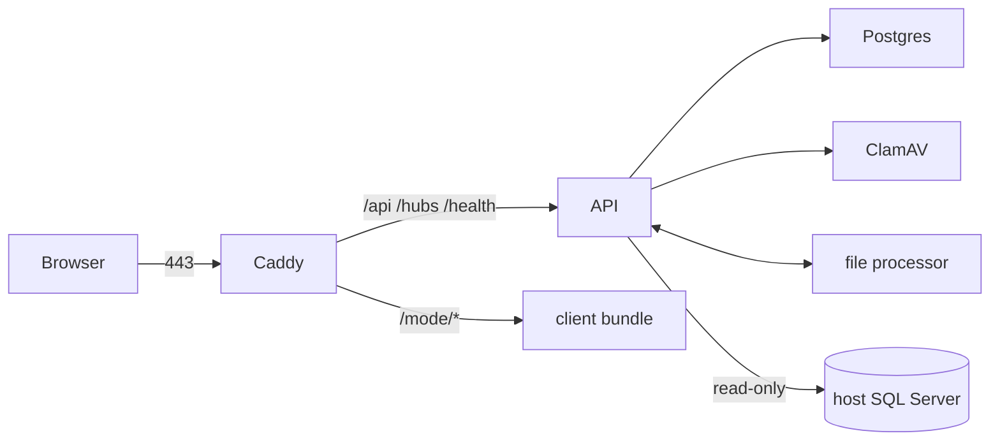

# Deploying Mode on one Linux server

One server running Docker Compose, with Caddy in front for automatic HTTPS. The files are in [deploy/](../deploy).



Only Caddy publishes ports (80, 443). Postgres, ClamAV, the file processor and the API are reachable only on the Compose network. `/internal/*` (processor callbacks) is not routed by Caddy.

## 1. Server

- Ubuntu 24.04 LTS (or similar), 4 vCPU, 8 GB RAM, 100 GB disk to start. ClamAV alone needs about 1.5 GB of RAM.
- Docker Engine 27+ with the Compose plugin.
- A DNS name (for example `mode.your-bank.example`) pointing at the server. Ports 80 and 443 open from the users' network; 80 is needed for the certificate challenge.
- Outbound access to the host SQL Server (1433), the host's sign-in metadata URL, Let's Encrypt, and the ClamAV signature mirror.
- Firewall: allow 22 (from admin networks only), 80, 443. Nothing else inbound.

## 2. First install

```sh
sudo mkdir -p /opt/mode && sudo chown $USER /opt/mode
git clone https://github.com/victorFaust/Mode.git /opt/mode && cd /opt/mode
git checkout v1.0.0                     # always deploy a tag

cd deploy
cp .env.production.example .env && chmod 600 .env
# Fill in .env. Generate each key with: openssl rand -base64 32
```

Settings in `.env`:

| Setting | What it is |
| --- | --- |
| `MODE_VERSION` | The release tag; used to tag images so a rollback can pick the previous one. |
| `MODE_DOMAIN`, `ACME_EMAIL` | Public name and the contact for Let's Encrypt. |
| `HOST_APP_ORIGIN` | The host application's origin; the only one CORS allows. |
| `AUTH_ISSUER`, `AUTH_AUDIENCE` | Must match the host's tokens exactly. |
| `AUTH_METADATA_ADDRESS` or `AUTH_PUBLIC_KEY_PEM` | Exactly one. Prefer the metadata URL so key rotation needs no redeploy. |
| `HOST_DIRECTORY_CONNECTION_STRING` | The read-only `mode_reader` login on the host SQL Server, with `Encrypt=True`. |
| `POSTGRES_PASSWORD`, `FILES_LINK_SIGNING_KEY`, `PROCESSOR_KEY`, `COMPLIANCE_SIGNING_KEY` | Random secrets. Keep a copy in the bank's secret store; the backup includes them too. |
| `PUSH_*`, `VAPID_*`, `EMAIL_*`, `SMTP_*` | Optional browser push and email digests. |

Build the embeddable client the host application loads (`mode.js` and `mode.css`, see [HOST-INTEGRATION.md](HOST-INTEGRATION.md)):

```sh
cd /opt/mode/client && npm ci && npx tsc --noEmit && npx vite build --mode lib \
  && rm -rf ../deploy/client-dist && cp -r dist-lib ../deploy/client-dist
```

Build, migrate and start:

```sh
cd /opt/mode/deploy
docker compose -f docker-compose.prod.yml build
docker compose -f docker-compose.prod.yml up -d postgres
# Migrations are applied by a one-off EF bundle, never by the API at startup.
cd .. && dotnet tool restore && dotnet tool run dotnet-ef migrations bundle --project src/Mode.Infrastructure \
  --startup-project src/Mode.Infrastructure --self-contained -r linux-x64 -o deploy/efbundle --force
cd deploy && docker compose -f docker-compose.prod.yml run --rm --no-deps -v "$PWD/efbundle:/efbundle:ro" --entrypoint /efbundle api \
  --connection "Host=postgres;Database=mode;Username=mode;Password=$(grep ^POSTGRES_PASSWORD= .env | cut -d= -f2-)"
docker compose -f docker-compose.prod.yml up -d
```

If the server has no .NET SDK, build `efbundle` on the build machine for `linux-x64` and copy it over.

Check it:

```sh
curl -fsS https://$MODE_DOMAIN/health/live      # 200: process up
curl -fsS https://$MODE_DOMAIN/health/ready     # 200: database and host directory reachable
docker compose -f docker-compose.prod.yml ps    # every service Up
```

Then sign in through the host application and send a message.

## 3. Upgrades

1. Read the release notes for migrations and new settings.
2. Take a backup: `./backup.sh` (see [RUNBOOK-backup-restore.md](RUNBOOK-backup-restore.md)).
3. `git fetch --tags && git checkout vX.Y.Z`, set `MODE_VERSION=X.Y.Z` in `.env`, rebuild the client bundle.
4. `docker compose -f docker-compose.prod.yml build`
5. Build and run the new `efbundle` (as in step 2 above).
6. `docker compose -f docker-compose.prod.yml up -d`; check `/health/ready` and sign in.

Realtime clients reconnect on their own and replay what they missed, so a restart drops nothing.

## 4. Rollback

The previous images stay tagged with their `MODE_VERSION`, so rolling back is a setting change.

- **No migration in the release:** set `MODE_VERSION` back to the previous tag, `git checkout` the previous tag, then `docker compose -f docker-compose.prod.yml up -d`.
- **The release had a migration:** prefer rolling back the code only if the migration was additive (new tables or columns; the old code ignores them). Otherwise roll back the database too:
  1. `docker compose -f docker-compose.prod.yml stop api caddy`
  2. Either run the previous release's bundle with the target migration name (`efbundle <PreviousMigration>`), which runs each migration's `Down`, or restore the backup taken in Upgrade step 2.
  3. Start the previous version as above.
- Messages sent between the upgrade and a restore-based rollback are lost; say so in the change ticket. The Governance migration's `Down` drops the audit-log triggers, so re-check them afterwards (see [SECURITY.md](SECURITY.md)).

## 5. Operations

- Logs: `docker compose -f docker-compose.prod.yml logs -f api` (JSON lines in Production). Ship them to the bank's log platform; see [MONITORING.md](MONITORING.md).
- Certificates renew automatically; Caddy keeps them in the `caddy_data` volume.
- ClamAV updates its signatures itself; alert if it stops (see monitoring).
- Scaling past one server needs a SignalR backplane and a shared connection registry; see D-entries in [DECISIONS.md](DECISIONS.md).
