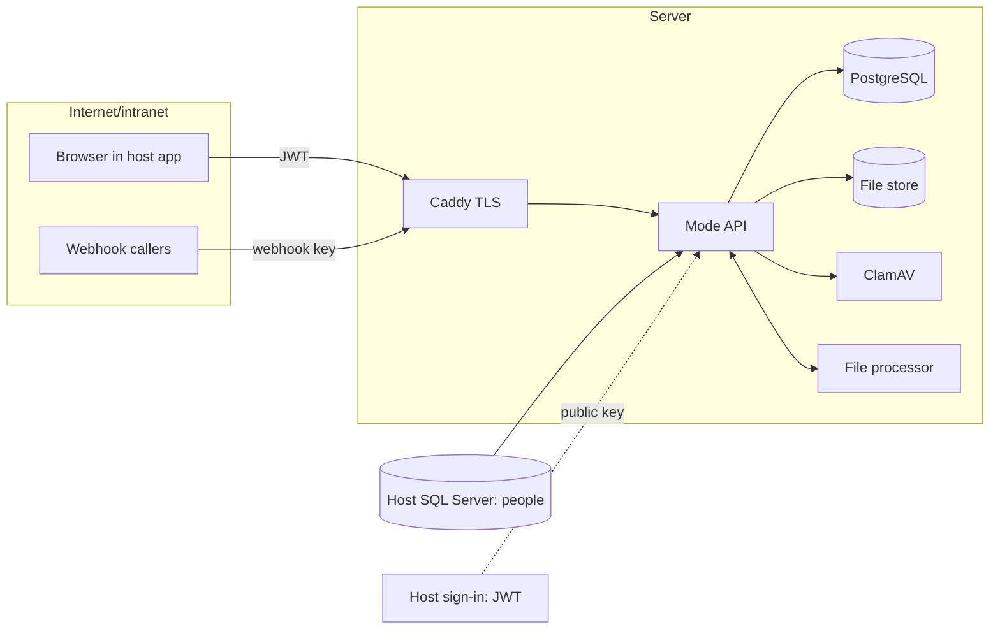

# Mode security

Threat model, the Prompt 10 review findings, the risks to accept, and the release checklist. Operational detail is in [DEPLOYMENT.md](DEPLOYMENT.md), [RUNBOOK-backup-restore.md](RUNBOOK-backup-restore.md) and [MONITORING.md](MONITORING.md).

## 1. Threat model

**What we protect:** message and file contents, who talks to whom, the audit log and compliance exports, and the signing keys.

**Trust boundaries**

| Actor | Can | Main threats | Controls |
| --- | --- | --- | --- |
| Outsider without a token | Reach Caddy | Token forgery, probing ids, flooding | JWT validated (signature, issuer, audience, lifetime, asymmetric algorithms only); every route except health, webhooks and signed file links requires a person in the host directory; rate limits; same 404 for "missing" and "not yours". |
| Signed-in person | Use the API as themselves | Reading other rooms (id guessing), keeping access after removal, escalating from guest, XSS in messages, malicious files, flooding | Central `AccessPolicy` on every room and message; access revoked live on membership change and on deactivation; server-side Markdown sanitizing plus a URL allow-list in the client; file allow-list, magic-byte check, ClamAV scan, `nosniff` and sandboxed downloads; per-person rate limits. |
| Mode administrator (host role) | Admin pages | Abuse of exports, holds, DLP | Every admin action is audited; the audit log is append-only in the database; exports are signed and their downloads audited. |
| Webhook holder | Post to one group chat | Key theft, flooding | 256-bit key stored as a hash, constant-time compare, rotate and revoke, 30 posts a minute per hook, DLP blocks apply. |
| File processor | Read originals, write previews | Compromise turning into wider access | Only short-lived signed links scoped to one version and purpose; not reachable from outside (`/internal` is not routed by Caddy). |
| Server or database operator | Everything on the box | Tampering, key theft | Out of scope for the app; mitigated by bank controls. The audit trigger stops casual edits but not a superuser (accepted risk R4). |

## 2. Review findings (Prompt 10)

Each finding has a test that failed on the code before the fix (verified by running the new tests against `main` at `7c0b4f1` in a separate worktree: 5 of 5 failed) and passes after it.

| # | Severity | Finding | Reproduce (test) | Fix |
| --- | --- | --- | --- | --- |
| F1 | High | No rate limits on sending, forwarding, search, people search, upload start or export requests. One person could flood a chat, run unbounded search load, or enumerate the directory. | `SecurityTests.Sending_is_rate_limited_per_person`, `Search_and_people_search_are_rate_limited` | Per-person fixed-window limits (per minute): send and forward 60, search 30, people search 60, upload start 20, export requests 5. 429 with `Retry-After`. Configurable as `RateLimits:<policy>PerMinute`. [ApiProtection.cs](../src/Mode.Api/Security/ApiProtection.cs) |
| F2 | High | A person deactivated in the host directory kept their live realtime connection, and kept receiving messages, until their token expired (up to the token lifetime). | `SecurityTests.Deactivated_person_loses_realtime_access` | `RealtimeSessionCheck` re-checks connected people against the directory every 60 s (`Realtime:RecheckSeconds`) and closes connections of anyone missing or inactive, with an `auth.realtime_revoked` audit entry. Worst case is the directory cache (5 min) plus one check. |
| F3 | Medium | No hardening headers on API responses (`X-Content-Type-Options`, `Referrer-Policy`, `X-Frame-Options`, CSP), and no HSTS. | `SecurityTests.Responses_carry_hardening_headers` | Middleware adds them to every response; `UseHsts` outside Development, and Caddy sends HSTS too. |
| F4 | Medium | No request body limit on JSON endpoints beyond Kestrel's 30 MB default, so large bodies could be used to tie up memory. | `SecurityTests.Oversized_json_bodies_are_refused` | 1 MB cap (413) for everything except the two file-content endpoints, which keep `Files:MaxSizeMb`. |
| F5 | Low | Behind a proxy, the audit log and per-IP limits would see the proxy's address. | Deployment review | `ForwardedHeaders:Enabled` (on in the production compose file) trusts `X-Forwarded-For` from Caddy; the API is reachable only on the private network. |
| F6 | Low | Jobs that exhausted their retries were logged at the same Warning level as a first failure, so "gave up" could not be alerted on. | Monitoring review | Logged at Error with "gave up after N attempts". |

Checked and already handled (tests that cover them):

| Area | Result | Evidence |
| --- | --- | --- |
| JWT: expired, wrong issuer, wrong audience, unsigned (`alg: none`), HMAC signed with the public key (algorithm confusion), foreign key, no expiry | Rejected | `AuthenticationTests.Invalid_tokens_are_rejected` (7 cases) |
| Token in the query string | Accepted only on the realtime hub path | `AuthenticationTests.Query_string_token_is_accepted_only_on_the_hub_path` |
| Realtime token expiry | Connection closed at expiry; expired tokens refused | `AuthenticationTests.Realtime_connection_*` |
| Tokens in logs | Not logged: the request log records the path without the query string, ASP.NET's own request logs are at Warning, and signed-link paths are redacted | `Program.cs` request log options, `appsettings.json`, `SignedLinkRedaction` |
| Cross-workspace id guessing | 404 and nothing changes | `CrossWorkspaceTests.Guessed_ids_from_another_workspace_return_not_found_and_change_nothing` |
| Removed members (channel, workspace, group chat) | Lose REST access and stop receiving realtime events at once | `RealtimeTests.Removed_*`, `SecurityTests.Removed_group_chat_member_stops_receiving_events_immediately`, `ConversationApiTests.Leaving_a_group_removes_access_*` |
| Guest escalation | Guests can't create workspaces or channels, search the directory, or chat outside their workspaces | `WorkspaceApiTests`, `ChannelApiTests`, `ConversationApiTests.Guests_can_only_chat_*`, `AccessPolicyTests` |
| XSS in messages | Raw HTML stripped, `javascript:`/`data:` links removed on the server; the client only renders allow-listed URL schemes | `MessageContentTests`, `MessagingApiTests` (bad link), client `components.test.tsx` |
| File upload abuse | Extension allow-list, content checked against the extension, ClamAV scan before anyone can download | `FileApiTests.Disguised_or_infected_files_are_blocked_and_removed` and others |
| Download headers | `attachment` with an RFC 5987 encoded name (quotes and `;` can't inject parameters), `nosniff`, sandbox CSP | `FileApiTests.Upload_is_scanned_*`, `SecurityTests.Download_names_with_quotes_and_separators_stay_in_the_filename` |
| Webhooks | Same 401 for unknown, revoked and wrong key; rotation invalidates the old key; rate-limited | `GovernanceTests.Webhooks_*` |
| Audit log tampering by the app | UPDATE, DELETE and TRUNCATE refused by the database | `GovernanceTests.Audit_log_rows_cannot_be_changed_or_removed` |
| Dependencies (2026-11-03) | 0 known vulnerabilities | `dotnet list package --vulnerable --include-transitive`: none; `npm audit` (prod and dev): 0; `pip-audit -r services/file-processor/requirements.txt`: none |

## 3. Risks to accept explicitly

| # | Risk | Why it remains | Mitigation |
| --- | --- | --- | --- |
| R1 | A leaked signed download link works for anyone for up to 5 minutes. | Links are opened by the browser directly (no bearer token), so they can't be tied to a person without cookies. | Short lifetime (`Files:DownloadLinkMinutes`), not logged, generated only after an access check. |
| R2 | A deactivated person can keep a live connection for up to about 6 minutes (directory cache plus one check), and can use REST until the directory cache expires (5 minutes). | Reading the host directory on every request would load the host SQL Server. | Lower `UserDirectory:CacheMinutes` and `Realtime:RecheckSeconds` if needed; the host should also stop issuing tokens immediately. |
| R3 | Bearer tokens can be replayed until they expire if stolen from a browser. | Inherent to bearer tokens issued by the host. | Short token lifetimes in the host; TLS only; tokens kept in memory by the client, not in storage. |
| R4 | A database superuser can disable the audit trigger. | Database-level protection only. | Restrict database access; ship audit entries to the bank's log platform for an independent copy. |
| R5 | One server: no high availability. Realtime connection state is in memory. | Deliberate for the first release (see DECISIONS). | Nightly backups, 4-hour restore target; scaling out needs a SignalR backplane. |
| R6 | Search runs against PostgreSQL full-text with a 200-character query limit and a 30-a-minute rate limit, but no per-query statement timeout. | A tuned timeout needs production data volumes to set. | Rate limit; add `statement_timeout` for the search role once production volumes are known. |
| R7 | Load capacity at 1,000 people is not yet measured on production-sized hardware (laptop run at 200 passed with no drops). | No server available yet. | Release gate G9 below. |

## 4. Go / no-go checklist

| # | Gate | Status |
| --- | --- | --- |
| G1 | All .NET, client unit and end-to-end tests pass on the release commit. | Done (see PR) |
| G2 | Dependency audits clean (.NET, npm, pip). | Done 2026-11-03 |
| G3 | Every finding F1 to F6 fixed with a passing test. | Done |
| G4 | Production `.env` filled; secrets generated fresh, stored in the bank's secret store, never reused from development. | To do at deployment |
| G5 | `AUTH_ISSUER`, `AUTH_AUDIENCE` and signing keys confirmed with the host team; a real host token signs in, a token for another audience is refused. | To do |
| G6 | Host directory login is read-only (`mode_reader`, SELECT on the users table only) with `Encrypt=True`. | To do |
| G7 | Firewall allows only 22 (admin networks), 80 and 443. `/internal`, Postgres and ClamAV not reachable from outside (check with `curl` and `nmap` from another machine). | To do |
| G8 | Backups running nightly and copied off the server; one full restore drill done on a test server. | To do |
| G9 | Load test with 1,000 people for 10 minutes on a staging server of production size meets the pass criteria in MONITORING.md. | To do |
| G10 | Monitoring and alerts from MONITORING.md wired up and tested (stop the API, see the page). | To do |
| G11 | Risks R1 to R7 accepted in writing by the system owner. | To do |
| G12 | Rollback rehearsed once on staging (deploy, roll back, data intact). | To do |

**Go** when G1 to G12 are all done. Today G1 to G3 are done; the rest need the target server and the host team.
